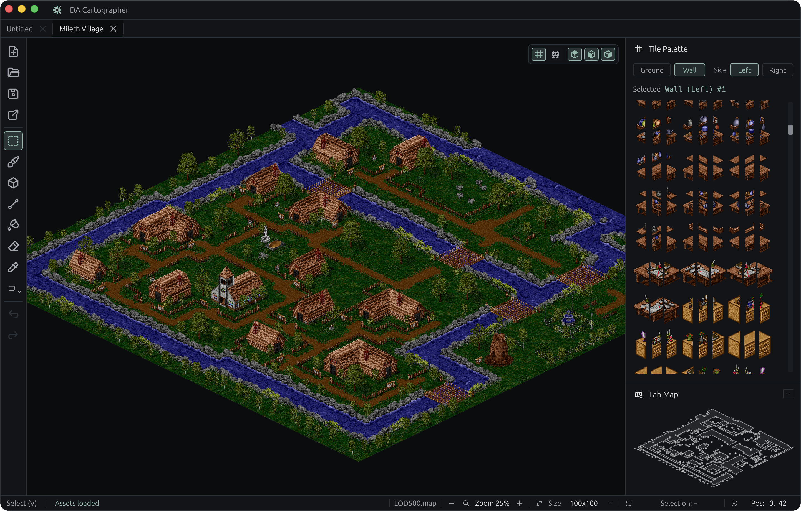

# DA Cartographer

A community map editor for Dark Ages. Open and paint isometric maps, save
reusable pieces as prefabs, and export your work as a PNG.



## Get started

1. Download the release for your system and extract it.
   - **Windows** — Open `cartographer.exe` from the extracted folder.
   - **macOS** — Open `DA Cartographer.app`.
   - **Linux** — Run `./install-desktop.sh` from the extracted folder, then
     open **DA Cartographer** from your application menu. To run it directly
     from the extracted folder, use `./cartographer`.
2. On first launch, choose your Dark Ages installation folder. The app copies
   the game's `.dat` archives into its own `assets` folder.
3. Open or drag in a `.map` file, or choose **New Map** to start from scratch.

On macOS, the app stores assets and prefabs under
`~/Library/Application Support/DA Cartographer`. On Linux, the desktop
installer puts the app and its data under `~/.local/share/da-cartographer`
(or your configured XDG data folder). When running the binary directly,
use the folder containing your `assets` and `maps.ron`.

## Make a map

- Pick a tile from the palette and use **Brush**, **Line**, **Shape**, or
  **Fill** to paint the ground and walls. Scroll to zoom and drag with the
  middle mouse button to pan.
- Select an area to move, copy, or save as a prefab. Use the **Prefab** tool
  to place it on another map.
- If a map opens at the wrong size, click its dimensions in the status bar.
  Use **Export** to save a PNG of the map or its collision view.

The editor reads older and newer Dark Ages asset packs, including animated
tiles and walls when their animation tables are available. See the
[editor guide](docs/EditorGuide.md) for asset setup, shortcuts, and prefabs.

## Build from source

With stable Rust installed, run this from the repository folder.

```sh
cargo run --release --locked -p cartographer
```

The binary builds to `target/release/cartographer` or
`target/release/cartographer.exe`. For a macOS app bundle, run
`packaging/macos.sh target/release/cartographer target/dist 0.6.0` after building.
